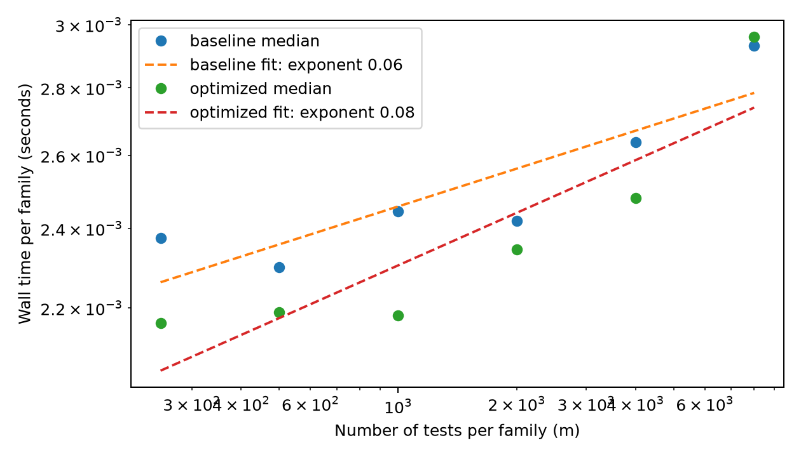

# Baseline Performance — Unit 2 Storey (2002) Simulation

## 1. Baseline provenance and environment

The **unmodified Unit 2 implementation** is preserved in `baseline/src/`. The primary study uses `configs/full.json`: 1,000 hypotheses per family, null proportions 0.1–0.9, alternative means 1, 2 and 3, two fixed thresholds (0.001 and 0.01), 1,000 replications per `(mu, pi0)` block, and 27,000 distinct simulated families. Reusing each family across both gamma levels and two methods gives 54 scenario conditions and 108,000 method-level rows. The master seed is `20261006`; all four methods/threshold combinations for a family use the same data.

Measurements below combine the uploaded local results with a subsequently measured **fresh historical Unit 2 worktree run**. Hardware: **MacBook Pro (Mac15,6), Apple M3 Pro, 12 CPU cores (6 performance and 6 efficiency), 18 GB unified memory**. Software environment: **macOS 15.7.4 (ARM64), Python 3.11.9** (`results/performance/environment.json`), with NumPy 2.4.6, SciPy 1.17.1, pandas 3.1.0, Matplotlib 3.11.2 and pytest 9.2.0 as recorded in the project run metadata. CPU and memory details were obtained using `system_profiler SPHardwareDataType`. Device serial numbers and identifiers are intentionally excluded.

## 2. Baseline runtime

The full Unit 2 workflow was remeasured **from a fresh output directory** using the historical `unit2-baseline` tag (original commit `bdbd36b`) in a detached Git worktree. The command ran the **original** `make all`, not the optimized Unit 3 engine:

```bash
/usr/bin/time -p make all PYTHON="$PYTHON_EXE" \
    CONFIG=configs/full.json OUT=results/unit2-full-pipeline-timing
```

| Quantity | Observed time | Provenance / interpretation |
|---|---:|---|
| Fresh historical **full pipeline wall clock** (`real`) | **19.85 s** | `/usr/bin/time -p` around original `make all`; includes startup, analysis and plotting |
| Historical full simulation (internal timer) | **8.4904 s** | `raw/metadata.json`, `simulation_seconds`, same worktree run |
| Historical analysis (internal timer) | **0.3815 s** | `summaries/metadata.json`, `analysis_seconds`, same worktree run |
| Historical figures (internal timer) | **1.3185 s** | `figures/metadata.json`, `figures_seconds`, same worktree run |
| Sum of internal stage timers | **10.1905 s** | Displayed total from the measurement script; approximately 10.1904 s from individually rounded values |
| Earlier baseline full simulation (internal timer) | **8.806 s** | `results/unit2-baseline-measurement/raw/metadata.json`, a different run |
| Uncached baseline full simulation (subprocess benchmark median) | **9.5714 s** | Median of three runs, `results/performance/benchmark.csv`; **simulation only** |

The external `/usr/bin/time -p` command also returned **user = 17.92 s** and **sys = 0.71 s**. The difference between `real = 19.85 s` and the sum of stage timers is expected: the Makefile launches separate Python processes for simulation, analysis and figures, and those function timers exclude interpreter startup, imports and other overhead outside the timed functions. **Do not add timings from different runs** or compare the 19.85-second full pipeline directly with simulation-only optimized benchmarks. A concise terminal record is retained in `results/performance/baseline_full_pipeline_timing.txt`.

## 3. cProfile evidence: baseline bottlenecks

The provided `baseline_profile.txt` concerns `configs/pilot.json`: 2,700 families and 10,800 method-level rows. It records **9,352,354 calls** (9,225,402 primitive) and **3.171 s** cumulative profiled execution time. The profiler includes interpreter import/startup work (approximately 1.15 s of import activity) and should **not** be used as the primary wall-clock speedup benchmark.

| Profile entry | Calls | Cumulative time | Meaning |
|---|---:|---:|---|
| `run_simulation` | 1 | 2.022 s | Baseline driver, including nested loops and writing |
| `DataFrame.to_dict` | 2,700 | **1.211 s** | Condition conversion redundantly executed once per family |
| pandas `to_dict` helper | 2,700 | 1.207 s | Internal component of the same `to_dict` cost; **do not sum** |
| `DataFrame.itertuples` | 2,700 | 0.936 s | Internal nested cost associated with frame conversion; **do not sum** |
| `generate_family` | 2,700 | 0.190 s | DGP generation; not the dominant source of inefficiency |

The repeated `conditions.to_dict('records')` conversion is **directly confirmed** as a substantial bottleneck. The redundant per-gamma scans, rejection masks and per-method truth metrics are verified from the implementation, but their isolated savings were **not** measured separately with the supplied profiler. The optimized code consequently targets both Python object overhead and repeated array operations. The original driver already reused a single stable argsort per family; **it would be inaccurate to claim the original code re-sorted p-values for each gamma**.

The complete profile is in `results/performance/baseline_profile.txt`. Its top-level `run_module`, imports and nested pandas entries overlap; their cumulative times should never be added together.

## 4. Complexity analysis

Let `m` be the number of hypotheses in a family, `G` the number of gamma thresholds, and `B` the number of generated families. DGP generation and metric evaluation are `O(m)`, BH sorting is `O(m log m)`, and threshold-specific counts/rejections cost `O(Gm)`. The baseline computational complexity is

\[ T_{\mathrm{baseline}}(B,m,G)=O\big(B(m\log m+Gm)\big), \]

in addition to CSV writing and startup/I/O overhead.

The empirical experiment varies `m` over {250, 500, 1,000, 2,000, 4,000, 8,000}, holding `pi0=0.5`, `mu=2`, two gamma thresholds and 300 replications fixed. Each measurement is repeated three times. The regression `log(runtime per family) ~ log(m)` gave:

| Engine | Empirical log-log exponent |
|---|---:|
| Baseline | **0.05985** |
| Optimized serial | **0.08315** |

These slopes are **not estimates of pure computational asymptotic order**: the benchmark times whole Python subprocesses and includes a relatively large nearly constant startup/import and serialization cost. The increasing runtime at larger `m` is consistent with rising array computation, but this experiment cannot reliably recover an `m log m` exponent. See `results/performance/complexity.png` and `complexity.csv`.



In particular, optimized serial at `m=8000` did **not** beat baseline in this small single-block test, although it was markedly faster in the full 27-block study.

## 5. Numerical stability at baseline

The original Unit 2 implementation uses `scipy.stats.norm.sf(z)` in place of `1 - norm.cdf(z)` to avoid catastrophic cancellation for large positive z, and uses `log1p`/`expm1` within analytic calculations. The uploaded baseline pilot run with `python -W always` generated `results/performance/baseline_warnings.log`. The file contains **INFO** messages only, with **0 numerical warnings** from this pilot run. This is evidence for the tested pilot configuration, **not** proof of zero warnings for every possible extreme parameter setting.

The core simulation uses closed-form formulas and BH thresholding, not iterative parameter estimation, so there is no iterative-optimizer convergence diagnostic to report. Numerical stress conditions for the optimized implementation are summarized in `docs/OPTIMIZATION.md`.

## 6. Optimization opportunities indicated by baseline

1. Move invariant pandas condition-to-dictionary conversion outside the replicate loop (**profile-confirmed**).
2. Reuse shared sorted p-values, FDR counts and cumulative null labels across threshold/method calculations (**code-confirmed**).
3. Compute multiple gamma decisions together and reduce repeated full-size Boolean rejection masks (**code-confirmed**).
4. Execute independent `(mu, pi0)` blocks in separate processes, preserving deterministic per-family RNG (**structurally supported**).
