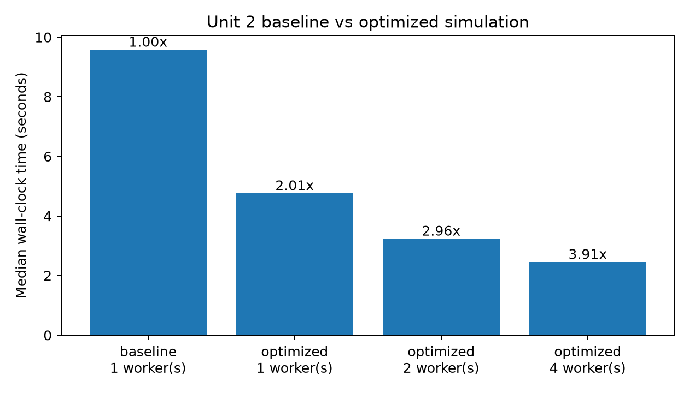
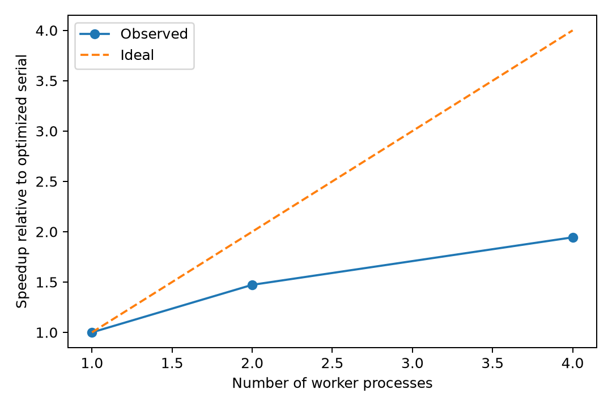
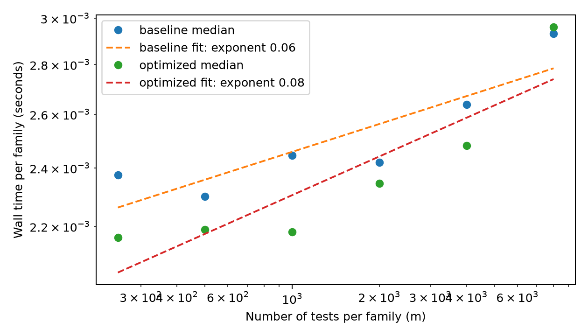

# Optimization and Validation — Unit 3

## 1. Experimental design and provenance

The optimized implementation preserves the Unit 2 design (27,000 generated families, 54 conditions, 108,000 method-level outputs, 1,000 hypotheses per family), random streams and CSV schema. Baseline implementation: `baseline/src/`; optimized driver: `src/simulation.py`; optimized calculation: `src/fast_kernel.py`. Both use the fixed master seed and family-dependent `SeedSequence`. All performance values below are derived from the supplied local files in `results/performance/` on a MacBook Pro (Apple M3 Pro, 12 CPU cores, 18 GB unified memory; macOS 15.7.4 ARM64, Python 3.11.9). The historical original Unit 2 `make all` was independently measured at 19.85 s full-pipeline wall time; it is **not** a simulation-only comparator for the benchmark below. Subprocess benchmark runs explicitly use `--force` and separate temporary output paths, preventing simulation-cache hits.

The full-simulation benchmarks repeated each configuration **three times**. Timings reflect end-to-end **simulation** wall-clock time, including interpreter startup, output and serializing data; they do not measure analysis or plotting. The `benchmark.csv` rows were run by implementation/worker group in a fixed order (baseline, optimized serial, optimized parallel), not randomized; possible thermal/system-order effects were not estimated.

## 2. Optimization A — algorithmic improvements / eliminate redundant work

**Profile-confirmed problem.** In Unit 2 the code executed pandas `conditions.to_dict('records')` inside the 1,000-replicate loop. With 2,700 pilot families this accounted for 2,700 calls and 1.211 seconds cumulative profiler time; it was the most obvious Python-level bottleneck after imports.

**Before (baseline):**

```python
conditions = design[(design.mu == mu) & (design.pi0 == pi0)]
for replicate in range(config["replicates"]):
    for condition in conditions.to_dict("records"):
        ...
```

**After (`src/simulation.py`):**

```python
conditions = design[(design.mu == mu) & (design.pi0 == pi0)].to_dict("records")
tasks.append((config, mu, pi0, conditions))
```

The original computation also repeated `W=#(p>lambda)`, null-proportion estimation, fixed rejection masks and per-method truth metrics across gamma thresholds. `src/fast_kernel.py` computes a family-level `W` and a null-count prefix sum once, and reuses these for both gamma conditions. The baseline already sorted p-values **once per family** and passed the order to the BH routine; the optimization is therefore *reuse beyond sorting*, not removal of repeated sorts.

**Impact.** The aggregate serial speedup for the combined algorithmic and vectorization changes was **2.013×** (baseline 9.5714 s versus optimized serial 4.7538 s, median). The individual contributions of the algorithmic change and array vectorization were **not isolated**; do not attribute this entire 2.013× to the condition-conversion fix.

**Trade-offs.** Reusing family-level statistics makes the optimized kernel more tightly coupled to multiple gamma conditions. It reduces Python work but requires stronger correctness testing to ensure no condition-specific quantity is inadvertently reused.

## 3. Optimization B — array programming and broadcasting

**Problem.** The original `estimate_fdr`, `reject_fixed`, `reject_bh` and `evaluate_rejections` functions produced separate masks and scanned truth labels repeatedly for each gamma and method.

**Before (baseline, abridged):**

```python
estimates = estimate_fdr(p, gamma, lam, cap_pi0)
fixed = reject_fixed(p, gamma)
bh, threshold = reject_bh(p, estimates["fdr_hat"], order)
fixed_metrics = evaluate_rejections(fixed, is_null)
bh_metrics = evaluate_rejections(bh, is_null)
```

**After (`src/fast_kernel.py`, abridged):**

```python
order = np.argsort(p, kind="stable")
sorted_p = p[order]
null_cumsum = np.cumsum(is_null[order], dtype=np.int64)
fixed_k = np.searchsorted(sorted_p, gammas, side="right")
eligible = sorted_p[:, None] <= fdr_hat[None, :] * ranks[:, None] / m
bh_k = np.max(np.where(eligible, ranks[:, None], 0), axis=0)
```

A prefix sum returns the number of null hypotheses among the first `k` sorted p-values, so counts, FDP and power are computed without constructing one full rejection mask per method and threshold. The BH decision still uses its correct rank-dependent step-up criterion. Broadcasting evaluates all gamma thresholds in a single matrix operation.

**Impact.** The combined serial result above is directly measured; no independent microbenchmark quantifies the array-programming contribution alone. This optimization changes constant factors but not the asymptotic main term, which remains `O(m log m + Gm)` per family.

**Trade-offs.** Broadcasting creates an `m × G` Boolean array, so memory usage grows with both tests and thresholds. With `G=2` this is modest; for very many gamma thresholds the memory–speed tradeoff would need re-evaluation. The compact code is less immediately readable than separate textbook-method functions.

## 4. Optimization C — parallelism across independent blocks

**Problem.** The 27 independent `(mu, pi0)` blocks ran serially in Unit 2.

**Before:** Nested `(mu, pi0, replicate)` Python loops on one process.

**After (`src/simulation.py`):**

```python
with ProcessPoolExecutor(max_workers=workers) as executor:
    block_results = executor.map(_simulate_block, tasks)
```

The actual driver manages pool lifetime explicitly (rather than literally using the context manager snippet above), and writes all returned rows in the **parent process** in fixed task order. It preserves `family_rng(master_seed, m, pi0, mu, replicate)`, so results are insensitive to worker scheduling. The parallel result rows are transferred between processes in memory; this incurs serialization and peak-memory costs.

**Measured impact (full simulation; median of three repetitions):**

| Implementation | Workers | Wall time (s) | Speedup vs baseline | Parallel speedup vs optimized serial |
|---|---:|---:|---:|---:|
| Baseline | 1 | **9.5714** | 1.00× | — |
| Optimized | 1 | **4.7538** | **2.013×** | 1.00× |
| Optimized | 2 | **3.2291** | **2.964×** | **1.472×** |
| Optimized | 4 | **2.4453** | **3.914×** | **1.944×** |

Three-run summary statistics for simulation-only wall times were: baseline `mean=9.5323 s, SD=0.0793 s`; optimized serial `mean=4.7331 s, SD=0.0545 s`; optimized 2-worker `mean=3.2390 s, SD=0.0175 s`; optimized 4-worker `mean=2.4409 s, SD=0.0109 s`. All groups had `n=3` runs. These dispersion estimates reflect short-run timing variability, not statistical uncertainty in FDR or power.





Parallel efficiency at four workers was **1.944/4 = 48.6%**. Speedup is sublinear due to process startup, task distribution, inter-process serialization, output writing and other serial work. Four workers gave the shortest time **among configurations tested**, not proof that four is globally optimal.

**Trade-offs.** Process management increases implementation complexity, each worker needs memory for a block's rows, and a worker task's rows are serialized back to the parent. Small problems may not benefit from parallelism; scheduling is not free.

## 5. Profiling and computational complexity evidence

The `configs/pilot.json` `cProfile` outputs gave **3.171 s** baseline versus **1.511 s** optimized profiled time. Profiling-run subprocess elapsed times were 3.285 and 1.614 seconds, respectively. Profiler runtime is not the preferred performance metric because instrumentation and imports influence results; the full-study multi-run benchmark in §4 is the primary speedup evidence. Notably, `DataFrame.to_dict` is invoked 2,700 times in the baseline pilot, and no longer appears as the leading bottleneck in the optimized profile. `fast_kernel.evaluate_family_fast` appears 2,700 times with **0.237 s** cumulative time in the optimized pilot. These cumulative timings overlap other profiler entries and cannot be summed.

With `B` families, `m` hypotheses and `G` thresholds, both engines are theoretically `O(B[m log m + Gm])`. The empirical `m` sweep (250–8000, 300 families, three repetitions per point) fitted log-log exponents of **0.05985** baseline and **0.08315** optimized. This is **not evidence for constant-time algorithms**: the experiment measured full Python subprocess wall time, dominated by nearly constant startup/import and output overhead in this small one-block design. At `m=8000`, the optimized median **0.002961 s/family** was slightly *slower* than baseline **0.002932 s/family**, a useful reminder that vectorization can add allocations and is not uniformly faster at every scale. Therefore, the full-study benchmark provides a more credible estimate of practical improvement for the actual application.



Files: `results/performance/baseline_profile.txt`, `optimized_profile.txt`, `benchmark.csv`, `benchmark.png`, `parallel_speedup.png`, `complexity.csv`, `complexity.png` and `complexity_slopes.json`.

## 6. Correctness and numerical stability

**Full-run reproducibility.** The independently generated full raw `replicates.csv` files for Unit 2 baseline and optimized serial have the **same SHA-256**, `50b136652aa501784a3d9aa90f849f2eddb1bef89a80f11d2c32b98b7a48b9bc`; their `design_matrix.csv` and `diagnostic.csv` hashes also match, according to the uploaded metadata. The full 108-row, 45-column summary CSVs from Unit 2 and Project 3 match at numerical precision; optimized full output has `validation.json` status `passed` with 108,000 method rows across 54 scenarios. These are stronger evidence than distribution-level tests alone.

**Regression tests.** `tests/test_regression.py` checks baseline versus optimized serial, serial versus 2-worker parallel on a small run, and hand/Unit-2 agreement for ties, zeros and no-rejection examples. The uploaded code was also run in a separate Linux/Python 3.13 check environment: **30 tests passed**; two `fork` deprecation warnings concerned the test environment's multiprocessing startup, not simulated numerical instability. Rerun `make test PYTHON=python` in the original macOS environment before submission and record its outcome.

**Numerical checks.** Uploaded `results/performance/stability.csv` includes **360 evaluations** across `m={100,1000,10000}`, `mu={0,2,5,8}`, multiple null proportions and replicate indices; the aggregate counts were **0 numerical warnings, 0 nonfinite outputs and 0 exceptions** for the optimized kernel. The baseline pilot warning log contains only ordinary INFO lines (0 numerical warnings in the tested pilot). The baseline uses `norm.sf`, `log1p` and `expm1` for sensitive probability calculations, so we cannot claim we newly invented these stabilizations. The study has no iterative optimizer whose convergence should be monitored.

## 7. Lessons learned

1. **Largest return on investment.** The combined serial cleanup and vectorization halved the full simulation wall time (2.013×), while adding four-process parallelism brought the overall speedup to 3.914×. The two categories' individual gains were not isolated.
2. **What profiling revealed.** A repeated pandas `DataFrame.to_dict` conversion, not just sorting or random-number generation, consumed more than a second of the profiled pilot; optimizing Python object manipulation mattered substantially.
3. **What was not universally beneficial.** The optimized version was not faster for every individual complexity-sweep point, notably the one-block `m=8000` case. Per-process overhead and allocations can dominate small jobs; a high worker count is similarly not automatically best.
4. **Statistical safeguards.** Byte-identical full raw outputs make the performance improvements especially credible: the optimized implementation changes *how* results are computed, not the scientific estimands or random families.
